# Texas ACM — redesign workspace

A working copy of the [Texas ACM website](https://www.texasacm.org/) for planning and building a redesign. Forked from [texasacm/website](https://github.com/texasacm/website).

**Baseline reviewed: November 1, 2026 (America/Chicago).** This README records the existing experience, its code structure, and proposed improvements. The redesign has not been implemented. Screenshots show the live original site, not a deployment of this fork; calendar events and other time-sensitive content will change.

## Redesign implementation — November 1, 2026

The redesign branch now opens with a maximalist **Texas ACM chapter** homepage that preserves the original Texas ACM SVG logo. The updated type system pairs Barlow Condensed headlines, IBM Plex Mono annotations, Archivo body text, and the existing Pagkaki handwriting. The intro reveals the original logo through circuit traces, scan lines, split shutters, and a brief color-channel effect. Earlier Campus Studio and After Hours directions remain at `/designs/studio` and `/designs/night`.

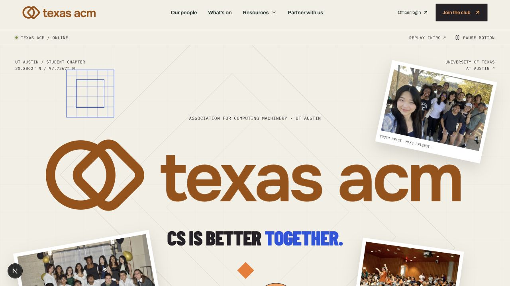

The new motion includes a skippable 3.2-second first-visit logo reveal (with replay), floating photos, rotating graphics, scroll parallax, section reveals, an animated marquee, hover reactions, draggable photos with reset, route entrance transitions, and a route-loading screen. A pause control stops ambient motion; reduced-motion preferences disable automatic animation and the intro. Photos in the memory wall come from the existing ACM archive. The separate Instagram feed refreshes periodically once the account manager connects it; it is **not connected live yet**. See [Instagram setup and account-manager handoff](docs/INSTAGRAM-SETUP.md).

[Mobile preview](docs/redesign/chapter-mobile.jpg) · [Photo wall](docs/redesign/alternate-universe-photo-wall.jpg) · [Logo reveal](docs/redesign/chapter-logo-reveal.jpg)

- [Design directions and Figma file](docs/DESIGN-DIRECTIONS.md)
- [Officer setup, permissions, and remaining launch steps](docs/OFFICER-SETUP.md)
- Local routes: `/designs`, `/designs/night`, `/officer`, and `/resources`.
- **Firebase connected locally:** `texas-acm-1bb6b` has email/password sign-in, Identity Platform, authenticator TOTP enabled, email enumeration protection, and the tested Firestore rules deployed on Spark. The first administrator is provisioned. Password setup, email verification, authenticator enrollment, and an end-to-end publish check require administrator onboarding. Production hosting and the server identity for officer invitations still need configuration.
- Content editors can manage events, announcements, resources, and forms. Other existing content remains source-managed.
- Use npm and `package-lock.json` for this implementation. Node 22+ is required; Node 24 LTS is recommended for Firebase tooling compatibility.
- Additional checks: `npm run typecheck`, `npm test`, and `npm run test:rules` (the last command needs Java and the Firebase CLI emulator).

## Current website screenshots

Actual browser captures are stored in [`docs/screenshots`](docs/screenshots). Desktop captures use a 1280 px wide viewport; mobile captures use 390 × 844. Most interior pages are captured in full. The homepage is captured in separate viewport images because its full-height hero does not make a useful full-page reference. Accordion contents and officer dialogs are closed in the baseline captures. The embedded Google Calendar did not visibly render event content in the capture environment; this is not confirmation that it fails for all visitors.

### Homepage — desktop

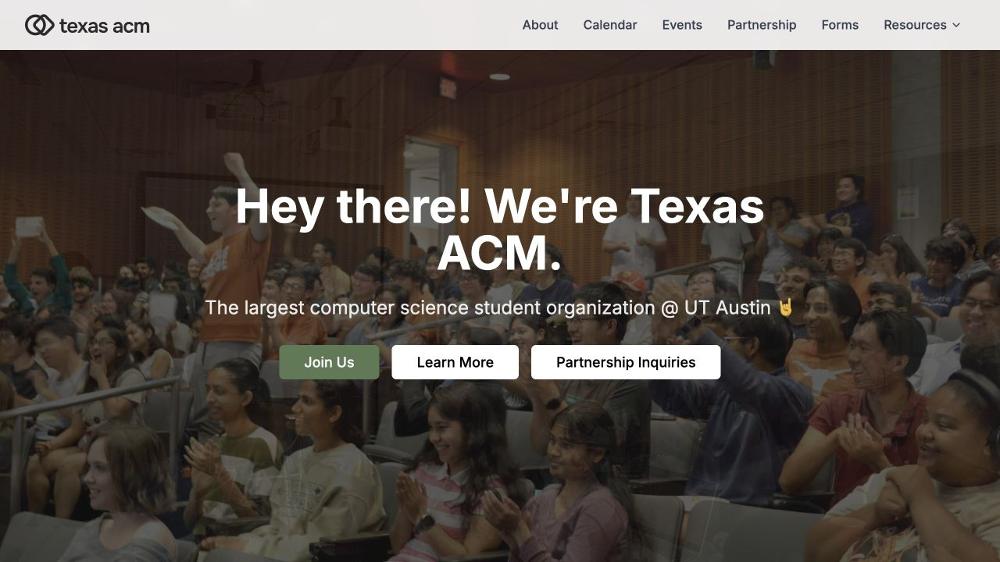

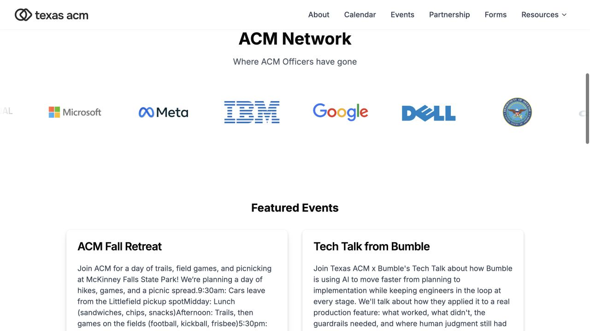

### Homepage and menu — mobile

| Homepage                                                                       | Menu open                                                                     |
| ------------------------------------------------------------------------------ | ----------------------------------------------------------------------------- |
| 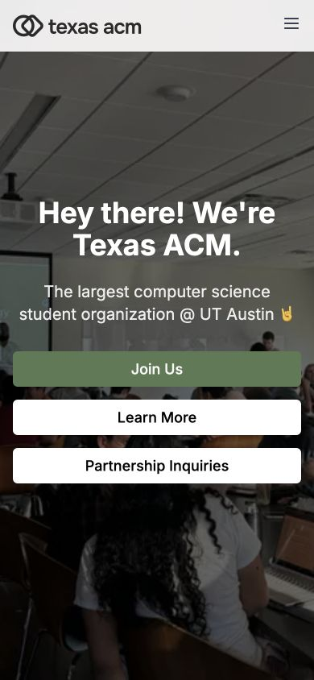 | 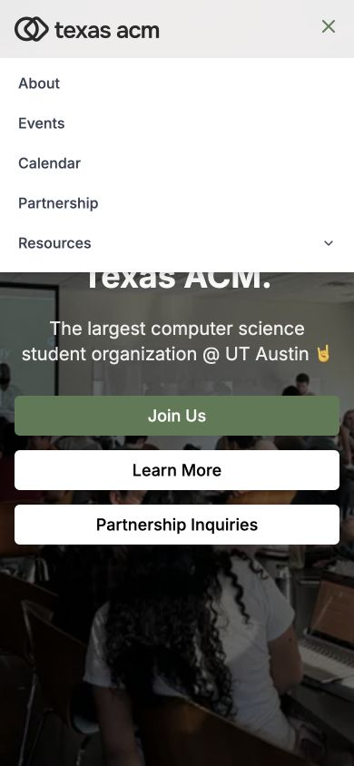 |

### Interior pages

Open a section to see the full-page baseline. These images document the current layout rather than proposed designs.

<details>
<summary>About and officer team</summary>

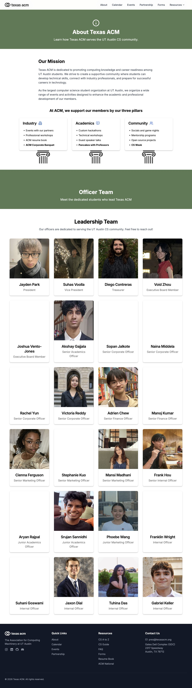

</details>

<details>
<summary>Events</summary>

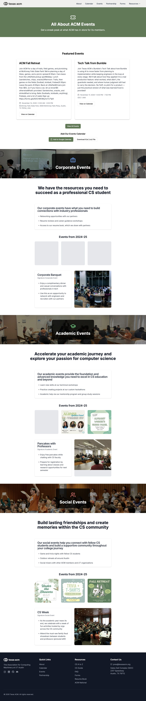

</details>

<details>
<summary>Calendar</summary>

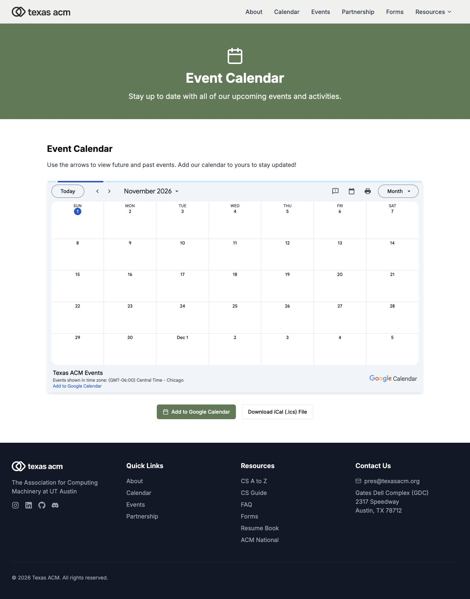

</details>

<details>
<summary>Corporate partnership</summary>

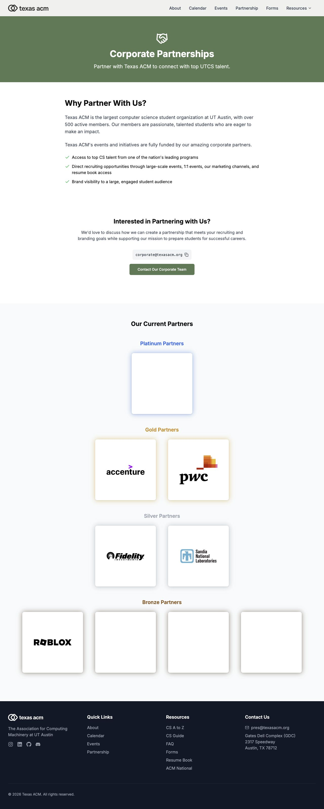

</details>

<details>
<summary>Forms</summary>

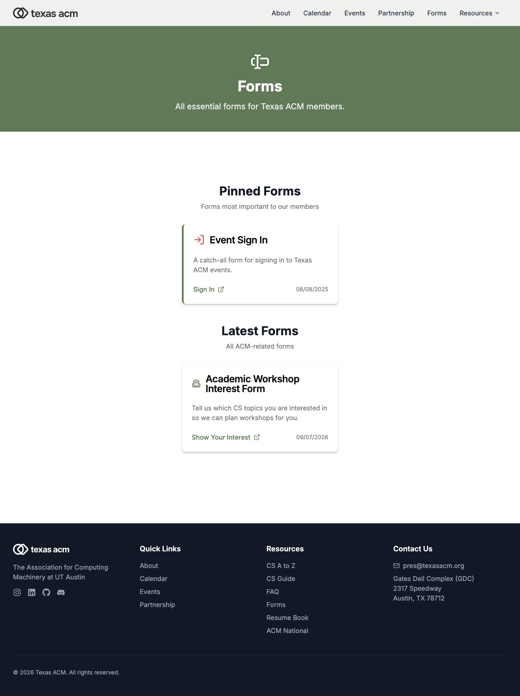

</details>

<details>
<summary>CS A-to-Z</summary>


</details>

<details>
<summary>CS Guide</summary>

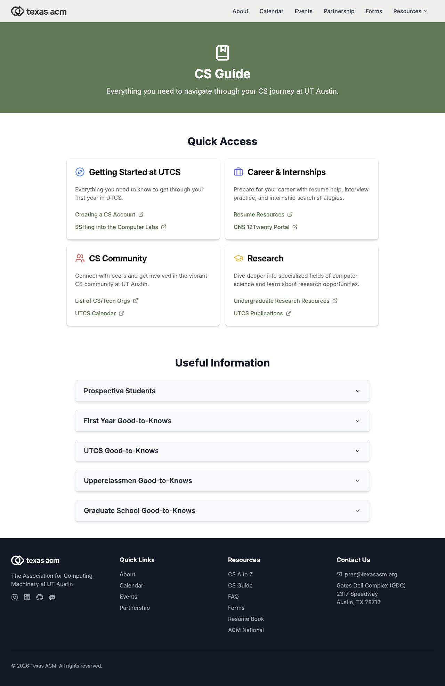

</details>

<details>
<summary>FAQ</summary>

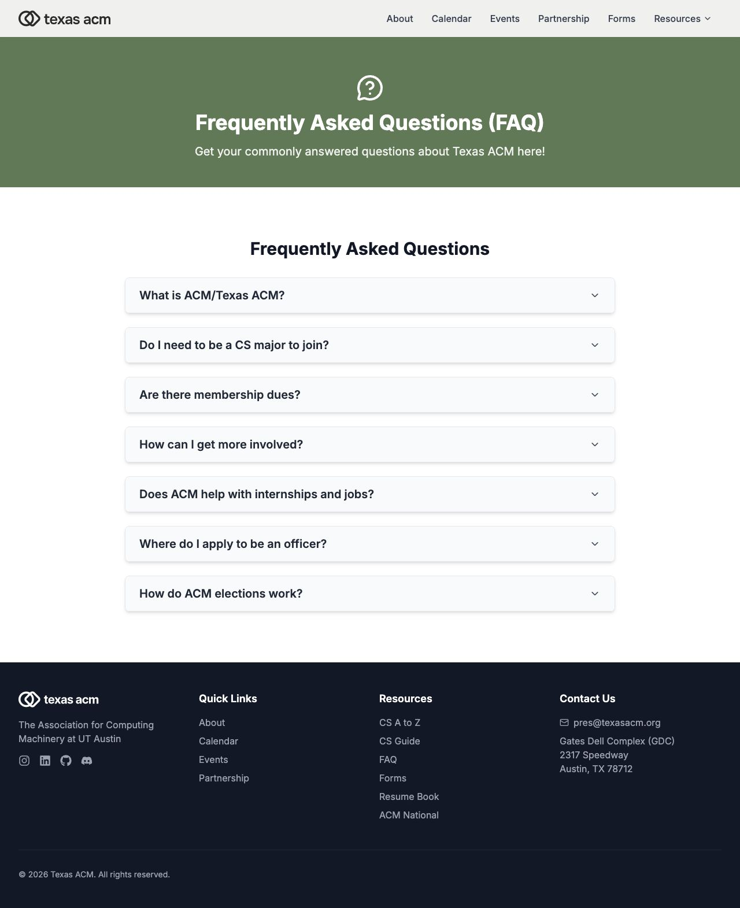

</details>

<details>
<summary>Resume book</summary>

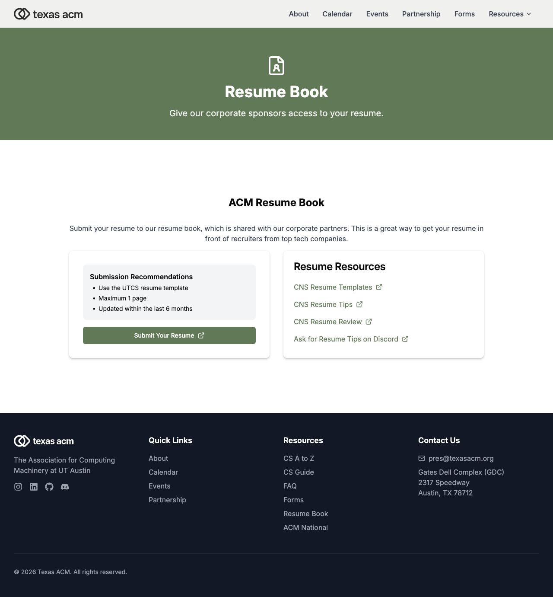

</details>

<details>
<summary>CS Week 2026</summary>

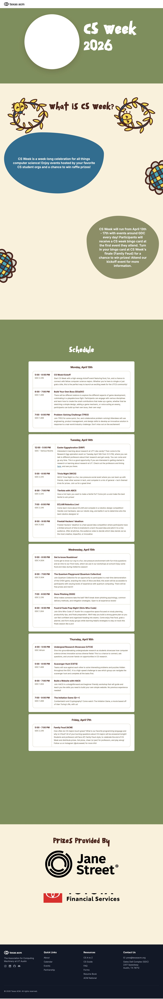

</details>

<details>
<summary>2026–27 executive board elections</summary>

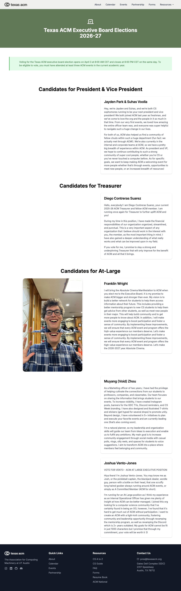

</details>

## What we currently have

### Pages and features

All 13 routes below exist in the source: 12 content pages and one redirect. The 12 content pages were opened for the screenshot baseline; external submissions were not completed.

| Route          | Current content / behavior                                                                                                                                                                                                                        | Main source                                                                                                                                                                                                    |
| -------------- | ------------------------------------------------------------------------------------------------------------------------------------------------------------------------------------------------------------------------------------------------- | -------------------------------------------------------------------------------------------------------------------------------------------------------------------------------------------------------------- |
| `/`            | Five-photo rotating hero; Join Us anchor; About and partnership links; scrolling ACM Network logos; next two calendar events; Google Calendar/iCal subscription links; mailing-list signup; Discord and social links.                             | [`app/page.tsx`](app/page.tsx), [`components/hero.tsx`](components/hero.tsx), [`components/featured-events.tsx`](components/featured-events.tsx), [`components/join-section.tsx`](components/join-section.tsx) |
| `/about`       | Mission; Industry, Academics, and Community pillars; leadership/officer grid with profile dialogs.                                                                                                                                                | [`app/about/page.tsx`](app/about/page.tsx), [`components/officer-team.tsx`](components/officer-team.tsx), [`lib/officers.ts`](lib/officers.ts)                                                                 |
| `/events`      | Next two upcoming events, followed by examples of corporate, academic, and social activities with photos and descriptions.                                                                                                                        | [`app/events/page.tsx`](app/events/page.tsx), event components in [`components`](components)                                                                                                                   |
| `/calendar`    | Embedded public Google Calendar, subscription action, and iCal download.                                                                                                                                                                          | [`components/google-calendar.tsx`](components/google-calendar.tsx)                                                                                                                                             |
| `/partnership` | Partnership benefits, corporate contact email with copy action, mailto action, and partners grouped into Platinum/Gold/Silver/Bronze tiers.                                                                                                       | [`app/partnership/page.tsx`](app/partnership/page.tsx), [`components/current-partners.tsx`](components/current-partners.tsx)                                                                                   |
| `/forms`       | Pinned and latest external form cards; deadline-based archive logic and collapsible archive when applicable. Current enabled data includes Event Sign In and Academic Workshop Interest Form.                                                     | [`lib/forms-data.tsx`](lib/forms-data.tsx), [`components/resources/forms/forms.tsx`](components/resources/forms/forms.tsx)                                                                                     |
| `/atoz`        | Long categorized glossary covering campus, courses, organizations, development tools, computing concepts, careers, and more. Some terms link to learning resources. All sections render together; no search or alphabetical index is implemented. | [`components/resources/atoz/atoz-content.tsx`](components/resources/atoz/atoz-content.tsx)                                                                                                                     |
| `/cs-guide`    | Quick-access resource cards plus expandable information for prospective/current students, UTCS topics, and opportunities.                                                                                                                         | [`components/resources/cs-guide`](components/resources/cs-guide)                                                                                                                                               |
| `/faq`         | Seven expandable answers on ACM, majors, dues, involvement, careers, officer applications, and elections.                                                                                                                                         | [`components/resources/faq/faq.tsx`](components/resources/faq/faq.tsx)                                                                                                                                         |
| `/resume-book` | Resume submission recommendations; external UTCS submission portal; CNS templates, tips, appointments, and Discord advice links. This site does not host a resume-upload service.                                                                 | [`components/resources/resume-book/resume-book.tsx`](components/resources/resume-book/resume-book.tsx)                                                                                                         |
| `/cs-week`     | Separate illustrated CS Week 2026 campaign with custom font/artwork, multi-day schedule, event details, and prize providers.                                                                                                                      | [`app/cs-week/page.tsx`](app/cs-week/page.tsx), [`components/cs-week`](components/cs-week)                                                                                                                     |
| `/election/26` | 2026–27 executive board candidate sections, photos, and statements.                                                                                                                                                                               | [`app/election/26/page.tsx`](app/election/26/page.tsx), [`lib/elections/Candidates2627.ts`](lib/elections/Candidates2627.ts)                                                                                   |
| `/signin`      | Redirect to the external event attendance form; not account authentication.                                                                                                                                                                       | [`app/signin/page.tsx`](app/signin/page.tsx), [`lib/constants.ts`](lib/constants.ts)                                                                                                                           |

### Shared experience and visual assets

- Fixed translucent desktop header with About, Calendar, Events, Partnership, Forms, and a Resources dropdown. Mobile has a hamburger menu and expandable Resources group; Forms moves inside Resources.
- Footer with quick links, resources, Instagram/LinkedIn/GitHub/Discord, president contact email, GDC address, and automatic copyright year.
- Olive-green primary color, white backgrounds, dark footer, rounded cards, icon-led interior banners, and Inter typography. CS Week has its own visual treatment and Pagkaki font.
- Existing local assets include ACM logo variants, community/event photos, officer portraits, corporate logos, flyers, and CS Week illustrations. See [`public`](public) and [`static/fonts`](static/fonts).
- Reusable Radix-based UI components include buttons, cards, dialogs, collapsibles, dropdowns, forms, and toast helpers. Styling uses Tailwind CSS; motion uses CSS and Framer Motion.

### Integrations and content ownership

| Item                           | How it currently works                                                                                                                                                                  | Redesign implication                                                                                                  |
| ------------------------------ | --------------------------------------------------------------------------------------------------------------------------------------------------------------------------------------- | --------------------------------------------------------------------------------------------------------------------- |
| Upcoming events                | Server fetch in [`lib/calendar.ts`](lib/calendar.ts) uses `GOOGLE_CAL_ID` and `GOOGLE_CAL_API_KEY`; home and Events request two upcoming items. Dates are displayed in America/Chicago. | Preserve the shared calendar as the source of event timing; distinguish fetch errors from a truly empty calendar.     |
| Calendar embed / subscriptions | Public calendar URLs are separately hardcoded in the calendar and featured-event components.                                                                                            | Centralize the calendar identifier so cards, embed, and subscription links stay aligned.                              |
| Flyers and RSVP links          | `eventExtras` in [`components/featured-events.tsx`](components/featured-events.tsx) matches exact calendar event titles.                                                                | Prefer a stable event identifier or a structured event record; changing a title currently breaks the match.           |
| Mailing list                   | [`components/EmailSignupForm.tsx`](components/EmailSignupForm.tsx) validates the email and posts a hidden form to Mailchimp in a new tab, with a honeypot.                              | Preserve the integration and explain the handoff; verify success/error feedback before launch.                        |
| Forms and sign-in              | External Qualtrics/Google Forms and other destinations; URLs in [`lib/constants.ts`](lib/constants.ts), records in [`lib/forms-data.tsx`](lib/forms-data.tsx).                          | Keep destinations centralized, track deadlines, and confirm which forms should remain active.                         |
| Officer/election content       | Stored in source files; profile UI lives in components.                                                                                                                                 | Establish a semester/year update checklist and a clear owner for roster changes.                                      |
| Sponsors                       | Tiered source data in `current-partners.tsx`; separate officer-employer logo strip in `ui/acm-network.tsx`.                                                                             | Preserve the distinction between current sponsors and companies where officers have worked.                           |
| Resources, FAQ, campaigns      | Mostly content embedded directly in components.                                                                                                                                         | Consider structured content files or a CMS if non-developers need frequent edits; a CMS is not currently implemented. |

## What may need to change

The items below are proposed work, not fixes already made. **Observed** means visible in the browser or directly established by source; **proposal** means a design direction to validate.

### Priority 1 — navigation, accessibility, and trustworthy states

| Finding                                                                                                                                                                                                                     | Evidence                                                                                                                                                         | Suggested change                                                                                                                              |
| --------------------------------------------------------------------------------------------------------------------------------------------------------------------------------------------------------------------------- | ---------------------------------------------------------------------------------------------------------------------------------------------------------------- | --------------------------------------------------------------------------------------------------------------------------------------------- |
| **Observed:** Desktop Resources is controlled only by mouse enter/leave. Its button has no click or keyboard-open handler.                                                                                                  | [`components/header.tsx`](components/header.tsx)                                                                                                                 | Use an accessible disclosure/menu with click and keyboard support, focus behavior, and expanded state.                                        |
| **Observed:** Multiple sections instantiate their own fixed Header. About renders it in both its About and Officer heroes; Events and CS Week repeat this pattern. Several pages also use multiple top-level `h1` headings. | Hero components, [`app/about/page.tsx`](app/about/page.tsx), [`app/events/page.tsx`](app/events/page.tsx), [`components/cs-week`](components/cs-week)            | Render one header per page/layout and use a consistent heading hierarchy.                                                                     |
| **Observed:** Missing calendar configuration and request failures both return `[]`, which the event cards label “No Upcoming Events.”                                                                                       | [`lib/calendar.ts`](lib/calendar.ts), [`components/featured-events.tsx`](components/featured-events.tsx)                                                         | Separate unavailable, empty, and successful results; offer a direct calendar fallback.                                                        |
| **Observed:** Footer/join social links are icon-only without explicit accessible labels. Mobile menu state is not exposed with `aria-expanded`.                                                                             | [`components/footer.tsx`](components/footer.tsx), [`components/join-section.tsx`](components/join-section.tsx), [`components/header.tsx`](components/header.tsx) | Add meaningful names and disclosure state; verify keyboard navigation, focus visibility, and touch targets.                                   |
| **Observed:** Hero advances every five seconds, all five hero images use `priority`, and the hero has no pause control or explicit reduced-motion handling. The logo strip already has reduced-motion CSS.                  | [`components/hero.tsx`](components/hero.tsx), [`components/ui/acm-network.tsx`](components/ui/acm-network.tsx)                                                   | Consider a single strong image or accessible carousel controls; prioritize the first image and respect reduced-motion preferences throughout. |
| **Observed:** Navigation differs by device: Forms is top-level on desktop and nested on mobile.                                                                                                                             | Desktop/mobile captures and `header.tsx`                                                                                                                         | Make the information hierarchy consistent and keep Join, next event, and key resources easy to find.                                          |

### Priority 2 — clearer page structure and stronger identity

- **Proposal: simplify the first visit.** Keep the community photography and a clear introduction; emphasize one primary Join action, the next event, and a concise explanation of what joining involves. The FAQ already says membership is free and open to other majors—bring that reassurance closer to Join.
- **Observed / proposal: shorten event previews.** Current cards can contain entire calendar descriptions, making the page hard to scan. Show date, time, location, category, and RSVP first; use a short summary with a details path. Preserve meaningful line breaks and links from calendar descriptions.
- **Proposal: clarify Calendar versus Events.** The calendar is a schedule; Events currently mixes upcoming cards with evergreen activity examples. Give each destination a clear purpose and use consistent labels for “View All Events.”
- **Observed / proposal: make resources findable.** A-to-Z renders a very long list without search or an index. Add search/category navigation and anchors; keep CS Guide as an orientation path and FAQ as short answers to avoid overlapping destinations.
- **Proposal: define a shared design system.** Agree on colors, type scale, spacing, image ratios, cards, buttons, and section layouts. Decide whether to retain olive green or introduce a stronger UT/Texas ACM palette; the color direction is not yet selected. Keep the distinctive CS Week artwork within an intentional campaign system.
- **Proposal: improve sponsor and officer presentation.** Normalize logo sizing and portrait crops; ensure useful officer details remain accessible on mobile and keyboard. Make partnership benefits and contact options easier to scan.
- **Observed / proposal: give dated content a lifecycle.** CS Week 2026 and the 2026–27 election have dedicated routes outside the normal desktop links. Decide how campaigns are discovered, archived, and updated without overwriting historical content.

### Priority 3 — maintainability and launch readiness

- **Observed:** [`next.config.mjs`](next.config.mjs) ignores TypeScript and ESLint build errors. Resolve existing issues and restore meaningful build checks before treating a successful build as release validation.
- **Observed:** Both `package-lock.json` and `pnpm-lock.yaml` are committed; several dependencies use `latest`. Choose one package manager and review/pin the dependency set for reproducible installs. This review did not perform a dependency security audit.
- **Observed:** Metadata is global in [`app/layout.tsx`](app/layout.tsx), including a `v0.dev` generator value. Add deliberate per-page titles/descriptions and sharing metadata; review sitemap/robots needs.
- **Observed:** The footer source link uses an older GitHub URL that redirects to the current upstream; join/footer GitHub destinations differ. Decide which links should point to the organization, upstream source, or redesign repository.
- **Observed:** Content and URLs are spread across components and `lib`. Consolidate reusable navigation, calendar identifiers, contacts, partner data, and content records. Review the deadline timezone conversion in the Forms component before relying on automatic archiving across deployments.
- **Proposal:** Inventory image dimensions/file sizes, optimize large photos and flyers, and measure real mobile performance. Check embedded-calendar usability with slow or blocked third-party content and provide a useful fallback.
- **Proposal:** Verify all external destinations, active sponsors, officer details, glossary facts, forms/deadlines, and election rules with ACM content owners. Existence in the code does not establish that a destination or policy is still current.

## Suggested redesign sequence

1. Agree on the primary visitor journeys: join ACM, find an event, find a student resource, and become a partner.
2. Confirm the sitemap and content owners; identify material to keep, update, or archive.
3. Design the shared header/footer and a homepage direction at desktop and mobile widths.
4. Design event cards/calendar fallbacks, resource navigation, and the partnership page using the same visual system.
5. Migrate the remaining content while preserving important routes and integration destinations.
6. Validate navigation, forms, accessibility, performance, and content before deploying the redesign.

## Development reference

### Stack and folders

- Next.js 15 App Router, React 18, TypeScript, Tailwind CSS 3.
- Radix UI primitives, Lucide/React Icons, Framer Motion, React Hook Form, and date-fns/date-fns-tz.
- `app/`: route pages, root layout, and global styles.
- `components/`: page sections; `components/ui/`: reusable UI; `components/resources/`: resource pages.
- `lib/`: calendar fetching, officer/election records, form records, shared URLs, and utilities.
- `public/` and `static/fonts/`: existing visual assets and fonts.
- `docs/screenshots/`: dated baseline referenced above.

### Local setup

The commands below use the existing npm lockfile; selecting a single package manager remains a proposed cleanup task.

```sh
git clone https://github.com/TanishC4444/texas-acm-redesign.git
cd texas-acm-redesign
npm ci
npm run dev
```

Open [localhost:3000](http://localhost:3000). To display upcoming event cards locally, create an untracked `.env.local`:

```dotenv
GOOGLE_CAL_ID=your-calendar-id
GOOGLE_CAL_API_KEY=your-calendar-api-key
```

These variables are read on the server. Without them, the current implementation shows its empty-event state; the separately configured public calendar embed and subscription links do not depend on these variables. Use appropriate API restrictions and do not commit credentials. Updating this fork does not provide access to the original site's deployment settings or integration accounts.

| Command          | Purpose                                                             |
| ---------------- | ------------------------------------------------------------------- |
| `npm run dev`    | Local development server                                            |
| `npm run build`  | Production build; currently skips type/lint failures as noted above |
| `npm start`      | Serve an existing production build                                  |
| `npm run lint`   | ESLint                                                              |
| `npm run check`  | Prettier formatting check                                           |
| `npm run format` | Rewrite files with Prettier                                         |

### Review scope

This baseline combines source inspection, live browser visits to every content route, desktop screenshots, and a mobile homepage/menu review. It is not a full accessibility, performance, dependency, or end-to-end audit. Mailing-list signup, resume submission, attendance recording, and other external forms were not submitted. No application code changed in this documentation update; build/lint checks were not run.

## License

The source repository includes the [MIT License](LICENSE), copyright Texas ACM. Preserve its notice when reusing the software. Existing brand, photography, and third-party assets remain part of the baseline inventory.
