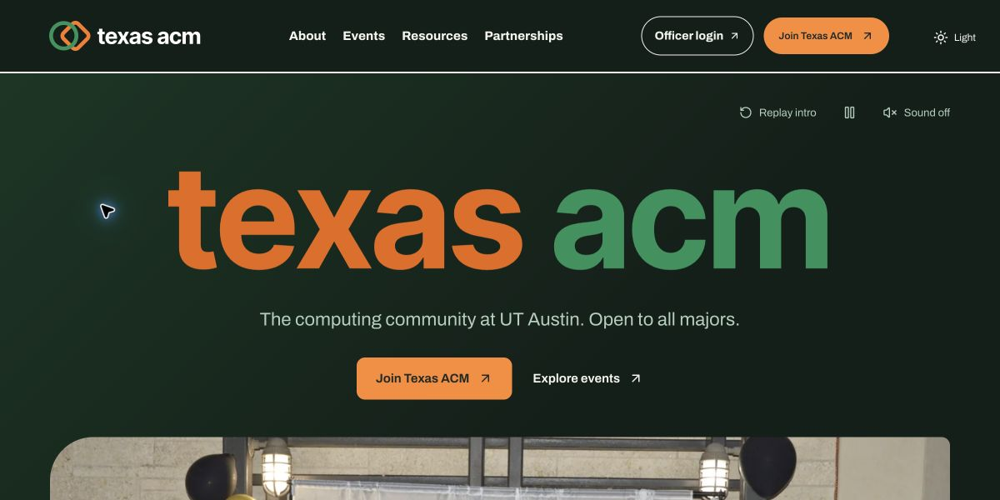

# Texas ACM Redesign

> **Work in progress.** Branch reconciliation and the checks below are engineering milestones. The redesign is still being developed; it is not a finished launch or a change to the official upstream site.

A reconciled working fork of [texasacm/website](https://github.com/texasacm/website), with a chapter website, interactive calendar, resource directory, officer tools, and Firebase-backed content. This repository is the fork, not the official upstream deployment.

## Run

Requires Node.js 22+.

```sh
npm ci
npm run dev
```

The development server uses `.next-dev` so it does not overwrite the production build. Copy `.env.example` to `.env.local` and configure Firebase to exercise officer tools. The public calendar supports the published calendar feed without a private API key.

## Checks

```sh
npm run typecheck
npm test
npm run build
npm run test:rules
```

The reconciled application passed TypeScript, 55 application tests, 25 Firestore/Storage rule tests, and a production build. Rule tests use emulators and synthetic identities; no real staff records were changed. Image and hook lint warnings remain non-blocking build warnings.

## Branch reconciliation

The current runtime combines the officer branch's backend/content/security work with the newer calendar branch's timezone handling, month view, focus controls, contrast behavior, and visual refinements. The previously reverted professional makeover stays reverted. The source working trees and original commit histories are retained in the merge ancestry and named source branches; no original local checkout was reset or deleted.

[Reconciliation details](docs/BRANCH-RECONCILIATION.md) · [Earlier design notes](docs/project-guide.md)

## Design preview — work in progress

This is a real local capture of the `codex/acm-professional-makeover-2026-11-26` branch at `14bdf16`, retained as a design reference. The design is still in progress; this is not an upstream production launch.


