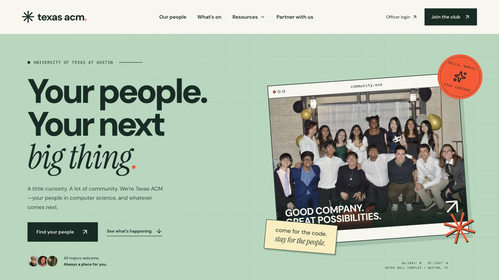
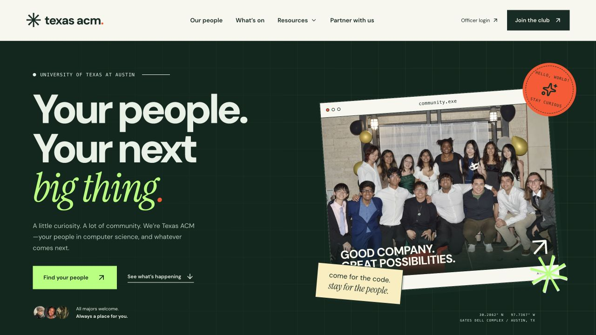
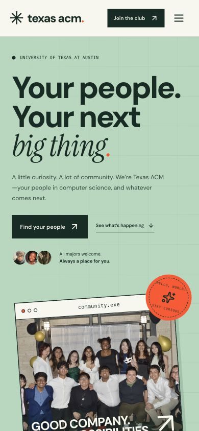
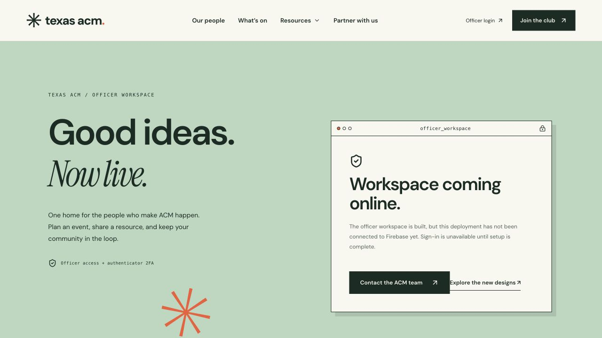

# Texas ACM design directions

[Editable Figma file](https://www.figma.com/design/urVxzjuJu8GHY8J37FgWBA) · [Instagram reference](https://www.instagram.com/texas_acm/)

## 01 — Campus Studio

The primary website direction at `/`: mint green, cream paper, deep green ink, and warm orange. Oversized DM Sans pairs with Instrument Serif. The community photo is treated as a retro desktop window; small editorial labels, a moving typographic ribbon, photo collage, and three distinct activity panels build on the visual language of ACM’s recent posts.

## 02 — After Hours

The alternate homepage at `/designs/night`: dark green/ink surfaces, electric mint emphasis, and warm orange. It retains the same content and functions so the palette and mood can be compared directly. The shared site header/footer remain the primary Campus Studio treatment.

The comparison page is `/designs`. Figma contains editable desktop explorations for both directions plus officer login and content-studio screens. It is an exploration file, not a claim that every migrated interior page has been independently designed in Figma.

## Source grounding

Reviewed the public `@texas_acm` grid on November 1, 2026. Visible posts included the All About ACM design, a collage/map treatment, retro-window technical workshop graphics, Personal Portfolio Creation, and the FAM interest form. The common themes were soft greens, cream, editorial type, playful windows, and collage. The website’s imagery uses existing ACM source-repository photos, not a scraped or automatically synchronized Instagram feed.

The work preserves membership, events, student resources, forms, sponsorships, officer profiles, election, and CS Week routes. The shared header/footer replaces repeated navigation, desktop Resources is keyboard/click accessible, A-to-Z gains search, and an officer-published content stream supplements source-managed pages.

## Motion and accessibility

The moving ribbon, hover treatments, and decorative graphics respect `prefers-reduced-motion`. Text content remains HTML rather than a rasterized design. New navigation has meaningful labels and expanded state, and all decorative imagery is separated from essential text. Mobile and desktop still require human acceptance before the original site is replaced.

## Working website previews

### Campus Studio

### After Hours

### Mobile

### Officer entry while Firebase setup is blocked

## Current direction: Alternate Universe

The homepage now uses a new maximalist direction, rather than the earlier split-column Campus Studio composition. A centered, oversized TEXAS ACM wordmark sits among floating archive photos and orbital graphics. Subsequent sections shift between oversized editorial typography, asymmetrical arched photo portals, live officer content, a draggable photo wall, a circular toolkit graphic, and a violet invitation panel. Palette: paper, near-black, acid green, violet, and peach.

Motion: timed, skippable first-visit intro with replay; CSS float/rotation; scroll-linked parallax; viewport entrance reveals; marquee; hover reactions; direct-manipulation photo dragging/reset; route loading and page entrances. Ambient motion can be paused; reduced-motion preferences disable automatic motion. The intro is a brand sequence, not a measure of network loading. The photo wall is temporary browser interaction and does not modify source photos or officer content.

The Figma file still documents the two earlier concepts. This new direction is implemented in code; it has not yet been mirrored into Figma. Earlier homepages remain at `/designs/studio` and `/designs/night`.

## Chapter identity refinement

The original Texas ACM logo assets are used unchanged in the header, hero, footer, and reveal (primary and white variants). The earlier improvised star wordmark is removed. The chapter-focused version replaces the generic serif/sans pairing with Barlow Condensed, IBM Plex Mono, Archivo, and the existing Pagkaki accent. New downloaded fonts are self-hosted with their OFL licenses. Copy explicitly identifies ACM, UT Austin, workshops, industry talks, and the student chapter. Circuit diagrams replace the floating planet treatment; the intro reveals the actual logo with scan lines, circuit traces, shutters, and color-channel slices, then clears after 3.2 seconds. It remains skippable, replayable, and disabled for reduced motion.

A separate latest-posts section is implemented using the official Instagram API. It requires the account manager’s authorized server configuration before it can show current posts; see INSTAGRAM-SETUP.md. No account access was assumed and no demo posts are presented as current Instagram content.

## Current: Chapter Space

The homepage is now a bounded, five-scene explorer: Chapter, People, Events, Toolkit, and Connect. Visitors move using scene tabs, keyboard arrows, or previous/next controls. The global glass dock navigates to the full informational pages, which retain scrolling for long content. Mobile scene panels can also scroll internally where needed. The layout does not intercept the browser’s wheel or disable normal browser navigation.

The chapter scene combines the unchanged original logo, real chapter photography, perspective photo cards, looping CSS 3D rings and a glass cube. Pointer movement adds a subtle camera tilt; reduced motion disables automatic animation. This is CSS perspective, not a WebGL environment or a loaded 3D model. Photo treatments are user-selected Original, Vivid, and Blueprint filters and do not recolor the logo. Fonts are predominantly Archivo with regular, upright headings; the scattered italic/serif emphasis is removed across pages.

Blue/cyan computing accents and warm UT orange appear in both light and dark themes. A translucent, layered, blurred dock links Explore, People, Events, Resources, Partners, Officers, Connect, and the theme toggle. Theme preference persists locally; the initial theme is applied before hydration, and toggling plays a color-wave transition. The new shared photo/glass hero is used on About, Events, Calendar, Partnerships, Resources, FAQ, Forms, CS Guide, CS A–Z, and Resume Book. Officer login panels also use the theme and glass treatment without modifying authentication logic.

Connection controls retain the actual Discord invite, existing Mailchimp signup, chapter email, and shared Google Calendar. The Events scene opens the calendar in a modal agenda view; the Instagram panel retains the authorized API integration/fallback. Discord remains an invite link; embedding a server chat widget would require the chapter’s server/widget configuration. Instagram remains pending its account manager’s connection. Source/archive photo sections are not represented as live Instagram posts.

The logo intro plays once per full page opening/reload, and can be replayed with the top replay control. Returning through client-side navigation does not replay it after completion. Its existing skip/Escape controls are preserved, and reduced motion bypasses it.

## Current direction after review: Computing machinery / vertical

The scene explorer and glass dock were rejected by the user. The active homepage is now a vertical, editorial layout with upright condensed display type, hard edges, full-width chapter images, and direct chapter navigation. Floating orbital graphics, glass cards, page docks, and scene tabs are no longer mounted or styled by the active layout. The `experience` files remain in source history but are not imported by the current homepage/layout.

Computing machinery informs the graphic language through circuit paths, connector-like square navigation ports, structured program rows, and a four-second logo assembly. The original logo SVG remains unchanged; eight clipped copies move into alignment while four shutters retract and circuit traces draw. A perspective board settles into a flat coordinate system, then the intro wipes upward into the page. There are no fabricated system statistics or fake terminal output. Copy names the actual chapter and its academics, industry, and community pillars.

The same hard-edged system replaces the glass treatment on informational page headers, officer login panels, buttons, and footer. Page titles are direct: Chapter events, Corporate partnerships, Chapter calendar, FAQ, Forms, CS Guide, and so on. Serif/italic emphasis remains disabled. Standard header navigation and a header theme toggle replace the dock. The live shared calendar now appears directly in the vertical homepage; Discord and newsletter signup remain operational links/forms. Instagram still needs account-manager authorization.
